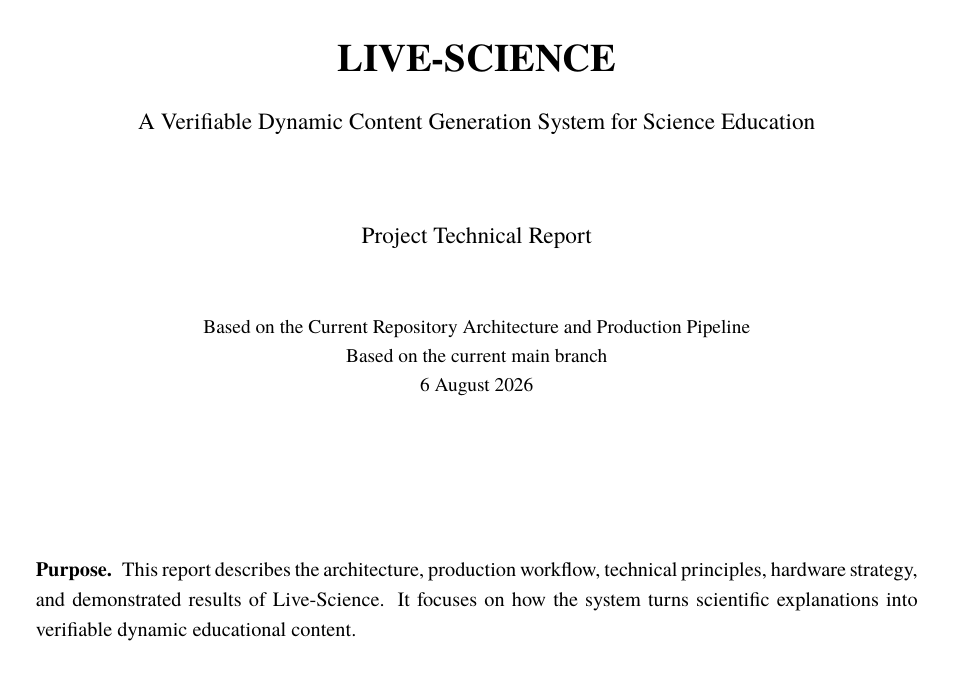
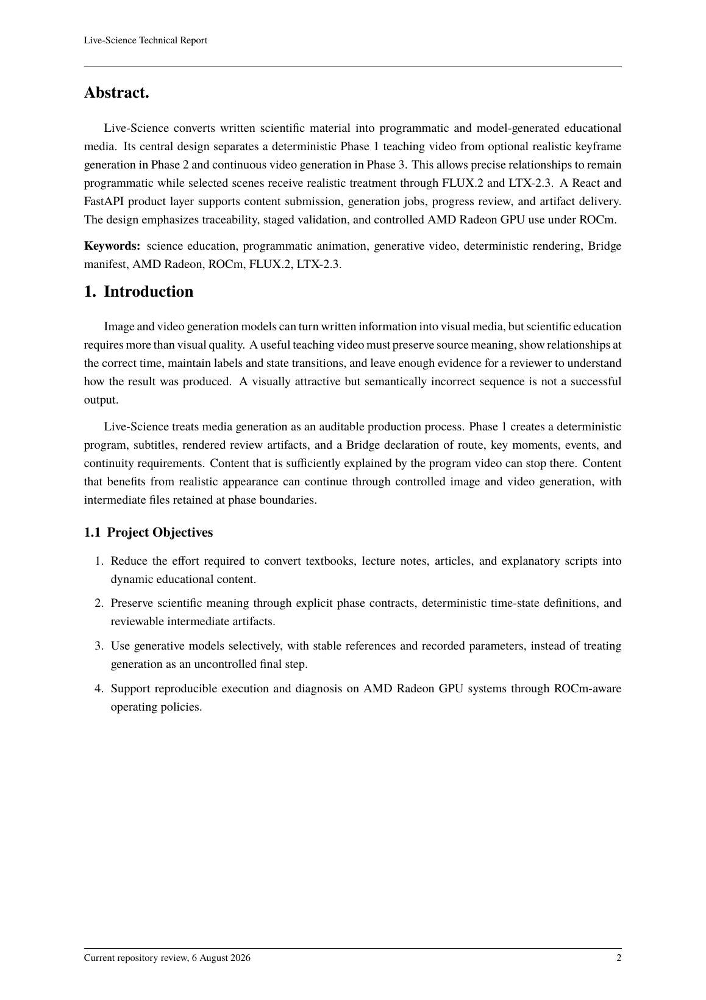
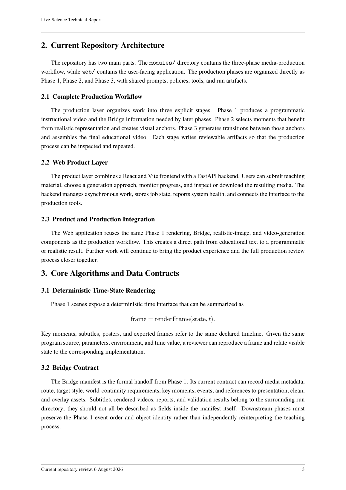
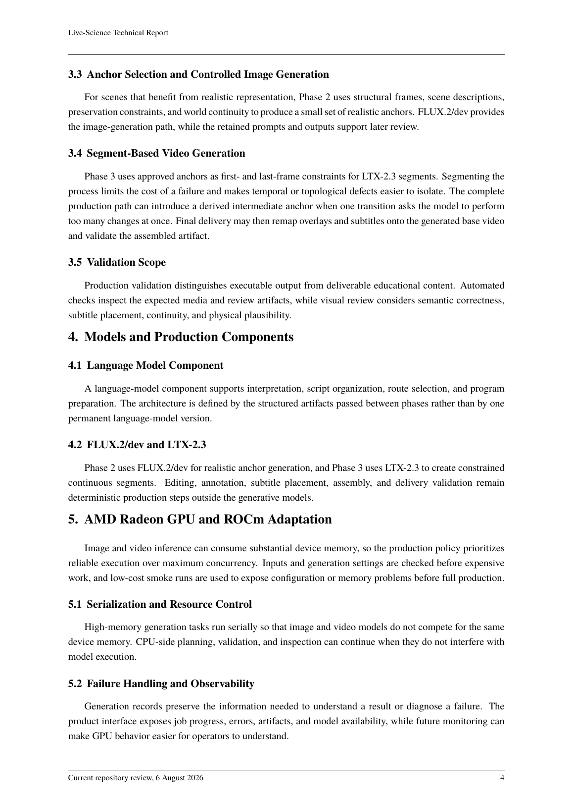
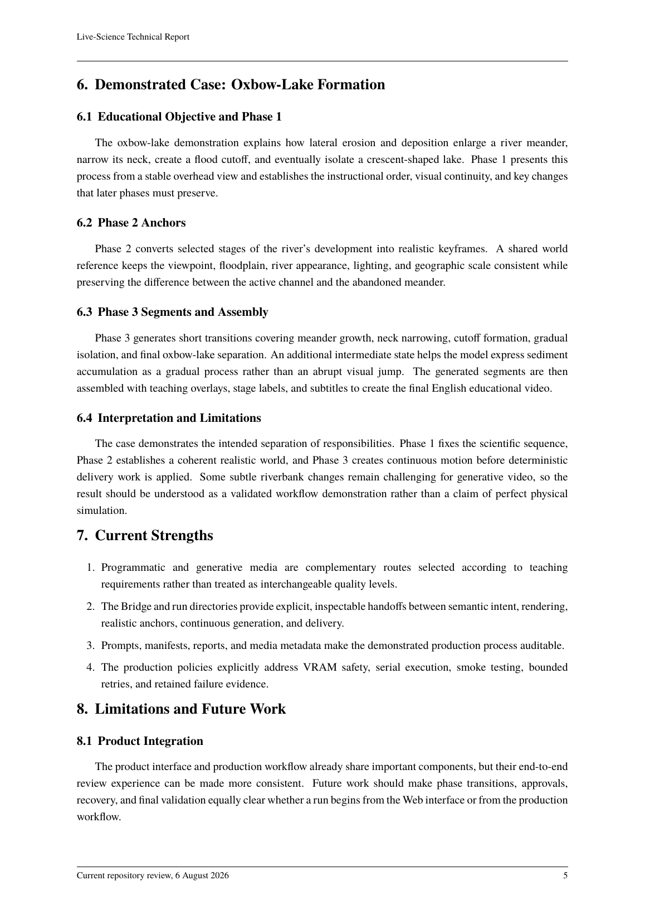
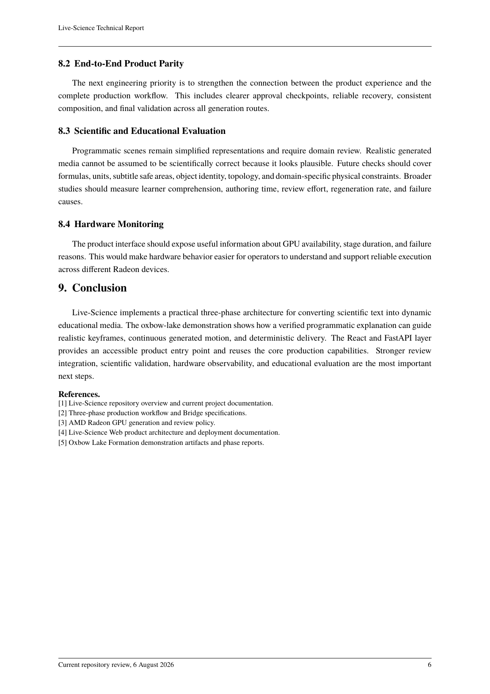

# Live-Science

Live-Science turns concepts from technical or educational documents into dynamic instructional videos. The three-phase workflow in `modules/` is the core production pipeline, while `web/` provides the product interface.

## Technical Report

The report describes the three-phase production pipeline, the Bridge handoff between stages, and how the workflow was tested with an oxbow-lake formation video.

[Open the full PDF](live-science-report-updated.pdf)

<a href="live-science-report-updated.pdf"></a>

<details>
<summary>Read the report here (pages 2–6)</summary>











</details>

## Core Production Workflow

The workflow in `modules/` transforms a user concept or teaching process into a captioned, publishable instructional video:

```text
User concept or teaching process
  → Phase 1: Programmatic instructional video and Bridge
  → Phase 2: Realistic keyframes
  → Phase 3: Continuous realistic video and final composition
```

See [`modules/README.md`](modules/README.md) for the authoritative specifications and detailed usage instructions.

Run the complete workflow with one command:

```bash
cd modules
python3 run_pipeline.py --request REQUEST.example.md --run-id seed-demo
```

Common options include `--quality smoke`, `--target realistic`, `--stop-after phase1|phase2`, `--resume --run-id <id>`, and `--dry-run`. All GPU tasks must also follow [`GPU_GENERATION_POLICY.md`](modules/GPU_GENERATION_POLICY.md).

## Product Interface: `web/`

`web/` is a decoupled frontend and backend product interface, with a React + Vite frontend and a FastAPI backend. It provides authentication, document planning, animation job management, and one-command public deployment. See [`web/README.md`](web/README.md) for details.

## Repository Structure

```text
├── README.md
├── modules/
│   ├── phase1/                     # Programmatic instructional video and Bridge
│   ├── phase2/                     # Realistic keyframes
│   ├── phase3/                     # Continuous video and final composition
│   └── run_pipeline.py             # Entry point for the three-phase workflow
└── web/                            # Product interface (React + FastAPI)
```
